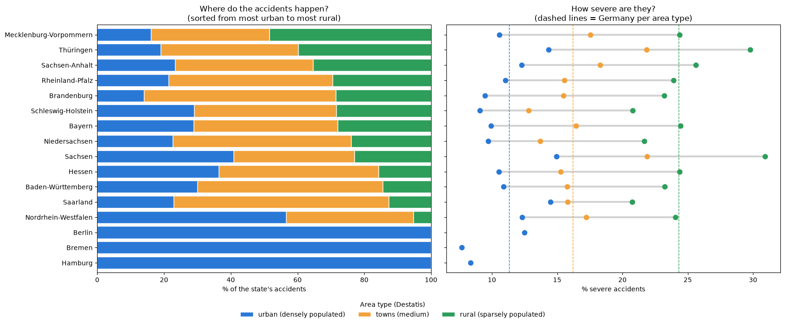

# Which Road Accidents End Badly? Predicting Severe Injury Accidents in Germany (2025)

**Team: The Random Forest Rangers**: Britt Schulze-Adesida · Jishnu Vasudevan · Micheal Eshak · Tiziano Cocciò · Zina Beek

When an injury accident happens on a German road, how likely is it that someone is **killed or seriously injured**? We use all police-recorded injury accidents from 2025 (Unfallatlas) together with official municipality data from Destatis to estimate this risk, using **only information that is known before an accident happens**.

## Business Case (Scenario C)

| | |
|---|---|
| **Stakeholders** | Municipal road planners, road-safety authorities, navigation and warning apps |
| **Question** | *If* an injury accident happens with these road users, at this place, time and conditions, how likely is it to be **severe**? |
| **Target** | `severe` = 1 if someone was killed or seriously injured (15.7 % of accidents), 0 if only slightly injured |
| **Metric** | **F1 score** for the severe class (with precision, recall and PR-AUC). Accuracy is misleading: always saying "not severe" is 84 % correct. |
| **Not used** | `accident_kind` and `accident_type`: they describe *how* the accident happened and are only known afterwards (leakage for prevention) |

## Data

| Source | Content |
|---|---|
| [Unfallatlas 2025](https://unfallatlas.statistikportal.de/) (Statistische Ämter des Bundes und der Länder) | Every accident with personal injury: place, time, light, road surface, road users, severity. Column guide: `data/DSB_Unfallatlas_EN.pdf` |
| [Destatis Gemeindeverzeichnis](https://www.destatis.de/DE/Themen/Laender-Regionen/Regionales/Gemeindeverzeichnis/_inhalt.html) (31.12.2025) | Population, area, density and official degree of urbanisation (urban / towns / rural) per municipality |
| [Destatis GENESIS 12411-0014](https://genesis.destatis.de/datenbank/online?sequenz=tabelleErgebnis&selectionname=12411-0014) | Population per state by age (used for the state-level EDA) |

**Shared team dataset:** `data/accidents_2025_with_population.csv`: **272,812 accidents × 41 columns**. 195 accidents (0.07 %) could not be matched to a municipality, mostly in uninhabited areas, and were left out.

## Key Findings

- **City vs countryside is the strongest factor:** 11.3 % of accidents are severe in cities, 16.2 % in towns and 24.3 % in rural areas, in every one of the 16 states. Most of the gap comes from the *same kind* of accident being more severe in rural areas, most likely because of higher speeds.
- **Who is involved matters next:** motorcycles 24.8 % severe (about 35 % on rural roads), trucks 21.0 %, pedestrians 19.2 %; accidents with a car are less often severe (13.7 %).
- **Time:** night (peak 26.3 % at 03:00) and weekends (Sunday 19.8 %) are riskier.



## Results

**Final model:** tuned gradient boosting (`zb05.ipynb`), 20 features known before an accident (road users, place incl. population density, time, light and road surface). Chosen by cross-validated PR-AUC on the training data (0.267); threshold 0.167 from out-of-fold predictions.

| Approach | Validation F1 | Test F1 (used once) | Test PR-AUC |
|---|---|---|---|
| Baseline: simple rule (motorcycle, pedestrian or no car) | 0.303 | 0.300 | – |
| Baseline: historical scenario lookup | 0.315 | 0.312 | 0.223 |
| Logistic regression | 0.334 | | |
| Decision tree | 0.326 | | |
| Random forest (tuned) | 0.340 | | |
| **Gradient boosting (tuned): final model** | **0.346** | **0.339** (95 % range 0.332–0.347) | **0.268** |
| Stacking ensemble (`Micheal_ML_Random_Forest_Rangers_Final.ipynb`) | 0.344 | | |

- **Test set (40,927 accidents, used once):** the final model beats the rule by **+0.039** (95 % range 0.033–0.046) and the historical lookup by **+0.027**. It finds **58 %** of severe accidents; about **1 in 4** flagged accidents is really severe (average: 1 in 6). Validation 0.346 → test 0.339: stable on unseen data.
- In the 10 % highest-risk accidents, **1 in 3** is severe (historical lookup: 27 %).
- All team notebooks reach the same level (**F1 ≈ 0.34**) with different code. Tuning and ensembles add very little: **the limit is the information in the data**, not the model.
- **Population density** is by far the most important feature (about 4–5× more than the next, motorcycle). The official urbanisation works almost as well, but adds nothing on top of density, so it is used to explain results, not in the model.
- **Calibrated:** mean predicted risk 15.6 % vs observed 15.7 %, all groups within about 1.3 percentage points.
- **Cities:** with one national threshold the model finds most severe accidents in rural areas (86 of 100) but only about 1 in 3 in cities.
- *Reference only:* a comparable gradient boosting model that also uses accident kind and type (not usable for prevention) reaches validation F1 0.375 (Micheal's notebook).

## Recommendations

1. **Prioritise rural roads**, especially for motorcycles: speed limits, safer curves and targeted campaigns.
2. **Use the model as a risk ranking**, not a yes/no decision; cities need their own threshold or model.
3. **Add the missing data:** road type and speed limits (e.g. OpenStreetMap) and several years of accidents.

**Data product idea:** a risk explorer for road planners: choose a place, time and road users and get the calibrated probability of a severe outcome, shown as a risk map, for targeted campaigns or live warnings in navigation apps.

**Limits:** the Unfallatlas does not record speed, road type, helmet or seatbelt use; density describes the whole municipality, not the road; one year only, random split.

## Repository Structure

| Folder / File | Owner | Content |
|---|---|---|
| **`notebooks/final/zb05.ipynb`** | Zina | **Final model:** urbanisation vs density, baselines, four models, tuning, calibration, error analysis and the final test |
| `notebooks/final/Micheal_ML_Random_Forest_Rangers_Final.ipynb` | Micheal | Team notebook: business case, EDA, baselines, three models, tuning, ensembles, ablation, calibration, error analysis, post-accident reference |
| `notebooks/zina/` | Zina | `zb01` data merge → shared dataset · `zb02` population by age · `zb03` first Scenario C models · `zb04` state-level EDA |
| `notebooks/micheal/` | Micheal | First EDA and baseline model |
| `notebooks/jishnu/` | Jishnu | Detailed EDA, historical scenario baseline, probability models, calibration, error analysis |
| `notebooks/tiziano/` | Tiziano | EDA, train/validation/test split, baselines, ensembles, educated-guess features, PCA |
| `presentation/` | | Final slide deck (PDF + PowerPoint); first draft in `presentation/draft/` |
| `images/` | | Project banner and plots (`images/plots/`) |
| `data/` | | Raw and processed data, splits |
| `models/` | | Saved model from Micheal's notebook |
| `results/` | | Saved tuning and ablation results |
| `course/` | | Course template files (assignment, Kanban board guide, example notebook) |

## Setup and Reproduction

Requires Python 3.13 and [uv](https://docs.astral.sh/uv/).

```bash
git clone https://github.com/zinaF19/The-Random-Forest-Rangers.git
cd The-Random-Forest-Rangers
uv sync
code .
```

Open the project folder in VS Code and select the `.venv` kernel. The notebooks run from the repo root (set in `.vscode/settings.json`), so `data/...` paths work from every folder. To reproduce the final result, run `notebooks/final/zb05.ipynb` (it uses `data/accidents_2025_with_population.csv`, `data/city_accidents_2025.csv` and `data/splits/`; about 30 minutes). The final test runs only with `RUN_TEST = True`.